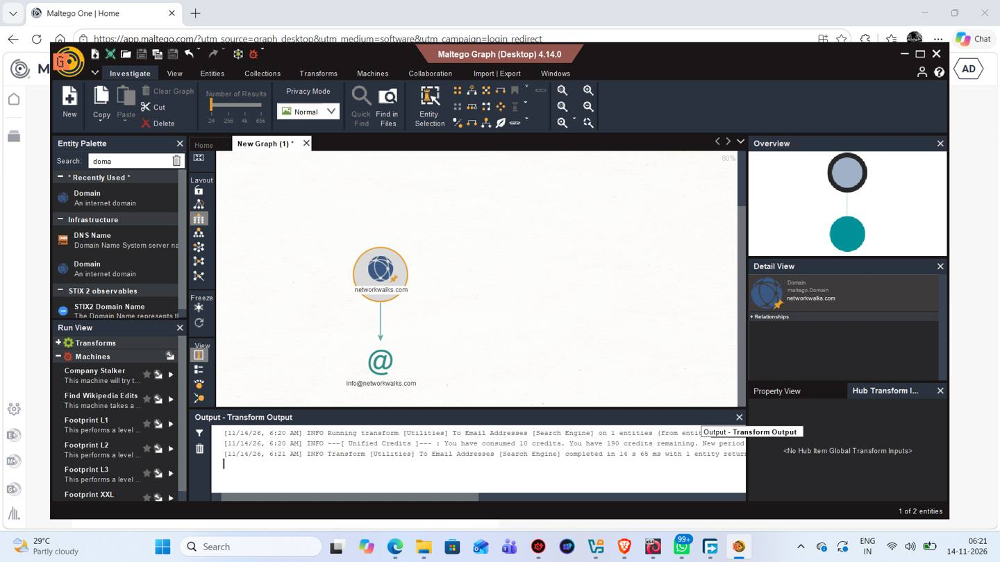
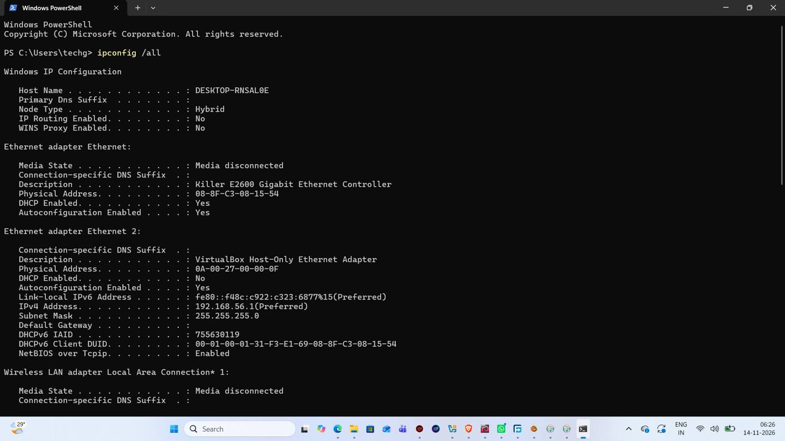
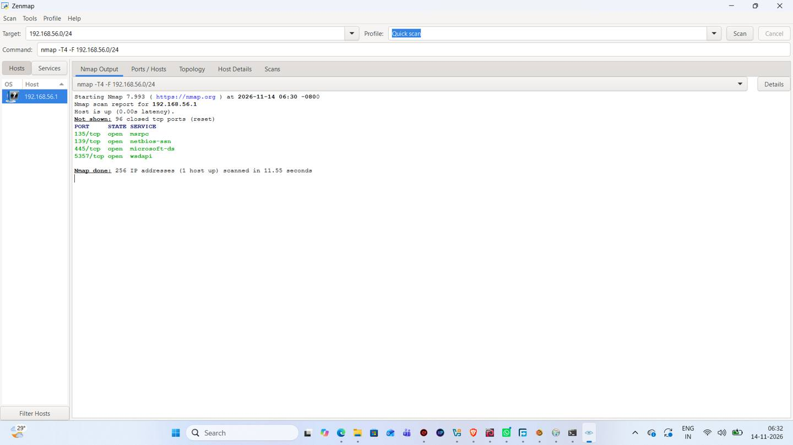
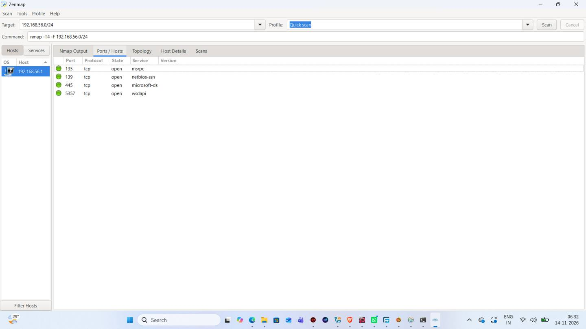
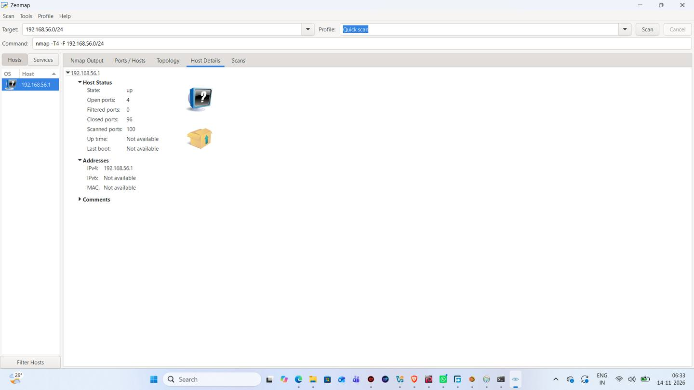
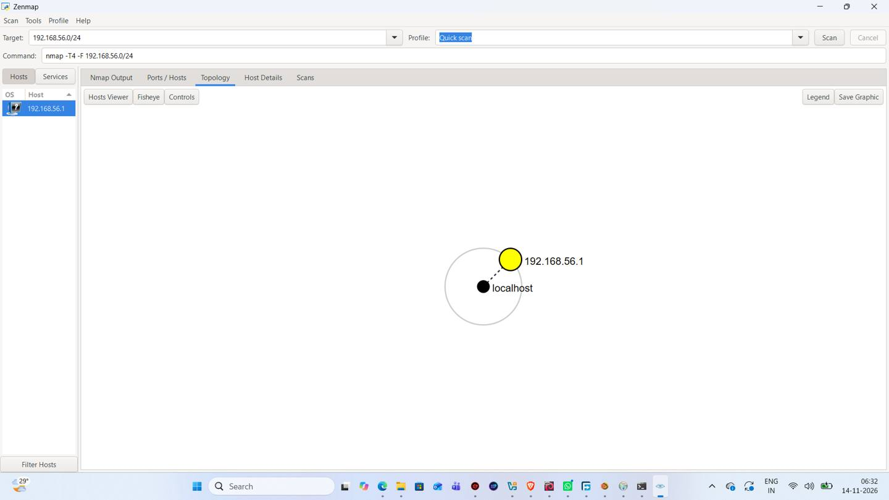
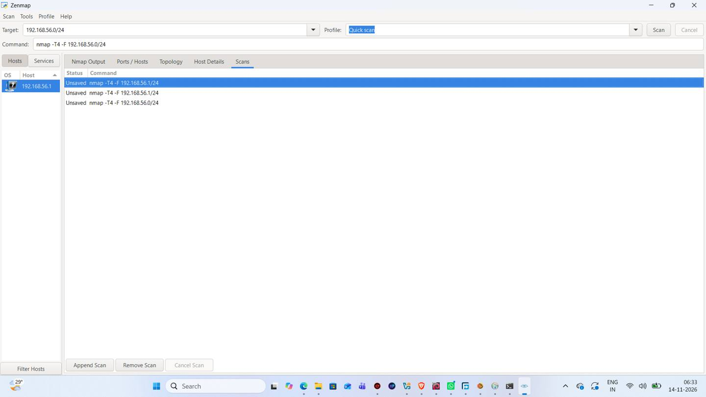
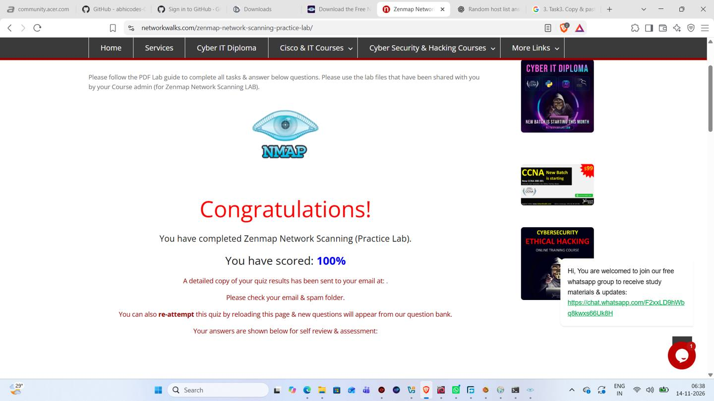

# Week 2: Cybersecurity — Footprinting and Network Scanning

**Networkwalks Cybersecurity Internship — Week 2**  
**Author:** Abhishek Deepak  
**GitHub:** [abhicodes-007](https://github.com/abhicodes-007)  
**Email:** abhishekdeepak002@gmail.com

This repository documents my Week 2 practical work using Maltego and Zenmap. The findings below are based on my captured lab screenshots and displayed command output.

## Modules

- **W2-PM3:** Maltego footprinting
- **W2-PM5:** Zenmap network scanning and host discovery

## Environment

| Property | Observed value |
|---|---|
| Host OS | Windows |
| Network adapter | VirtualBox Host-Only Ethernet Adapter |
| IPv4 address | 192.168.56.1 |
| Subnet mask | 255.255.255.0 |
| Scanner | Zenmap / Nmap 7.993 |
| Scan target | 192.168.56.0/24 |
| Scan profile | Quick scan |
| Command | `nmap -T4 -F 192.168.56.0/24` |
| Maltego version | 4.14.0 |

## W2-PM3: Maltego footprinting

I launched Maltego Graph 4.14.0, created a new graph and added the `networkwalks.com` domain entity. I ran the available **To Email Addresses [Search Engine]** transform.

The captured graph shows the domain connected to the email entity `info@networkwalks.com`. The transform output reports that it completed and returned an entity. This section records only what is visible in my screenshot.



## W2-PM5: Zenmap network scanning

### 1. Local adapter configuration

I ran `ipconfig /all` in PowerShell. The relevant adapter is **Ethernet 2**, identified as the **VirtualBox Host-Only Ethernet Adapter**.

| Property | Value |
|---|---|
| IPv4 address | `192.168.56.1` |
| Subnet mask | `255.255.255.0` |
| Physical address | `0A-00-27-00-00-0F` |
| DHCP | Disabled |



### 2. Zenmap scan results

Scan command:

```bash
nmap -T4 -F 192.168.56.0/24
```

Zenmap reports **256 IP addresses scanned** and **1 host up**, with a scan duration of 11.55 seconds.

**Live host:**

```text
192.168.56.1
```



### 3. Open TCP ports

| Port | Protocol | State | Service |
|---:|---|---|---|
| 135 | TCP | Open | msrpc |
| 139 | TCP | Open | netbios-ssn |
| 445 | TCP | Open | microsoft-ds |
| 5357 | TCP | Open | wsdapi |



### 4. Host details and topology

Zenmap's Host Details tab reports:

- Host state: Up
- Open ports: 4
- Filtered ports: 0
- Closed ports: 96
- Scanned ports: 100
- IPv4: `192.168.56.1`
- MAC: **Not available**

The topology view displays `192.168.56.1` connected to `localhost`.







The browser completion page also shows that the Zenmap Network Scanning Practice Lab was completed with a score of 100%.



## Task answers

**Task 3 — List of live hosts**

```text
192.168.56.1
```

**Task 4 — Number of live hosts:** 1

**Task 5 — Live host IP address:** `192.168.56.1`

**Task 6 — MAC address:** Zenmap's Host Details pane shows **Not available**. The PowerShell screenshot separately shows the local VirtualBox host-only adapter's physical address as `0A-00-27-00-00-0F`. These are distinct observations; the Zenmap host record did not provide a MAC address.

**Task 7 — PDF and LinkedIn:** The topology is captured as a screenshot. The supplied evidence does not establish that a PDF was saved or that the topology was shared on LinkedIn, so those actions are not marked complete.

## Key takeaways

- Identified the local VirtualBox host-only adapter and its IPv4 configuration.
- Used Zenmap to scan the `192.168.56.0/24` subnet.
- Identified one responding host in the scan output.
- Reviewed open TCP ports and host details.
- Used a Maltego transform to explore a domain-to-email relationship.

## Conclusion

This practical provided hands-on experience with basic domain footprinting using Maltego and local network host discovery using Zenmap. The findings in this repository are limited to the captured output and screenshots.

---

**Abhishek Deepak**  
Networkwalks Cybersecurity Internship — Week 2  
November 2026
